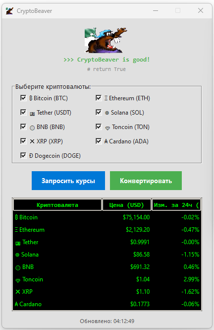
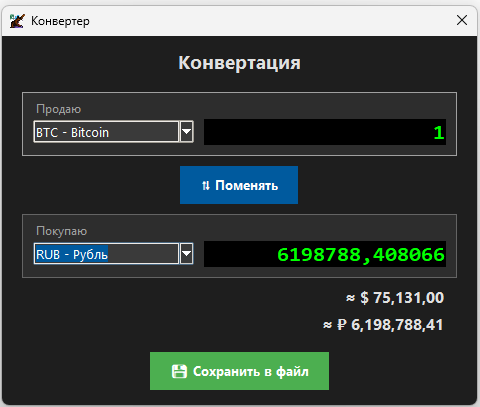

# 🦫 Crypto Beaver — калькулятор криптовалют на Python

Выпускная аттестационная (проектная) работа по программе профессиональной переподготовки
**«Азбука цифры. Python-программист»** (Центр повышения квалификации и профессиональной
подготовки «Основание»).

**Автор:** Любомиров Максим Григорьевич
**Дата:** 09.11.2026

---

## 📖 О проекте

**Crypto Beaver**  — настольное приложение на Python,
которое показывает актуальные курсы популярных криптовалют и позволяет быстро
конвертировать их в фиатные валюты (USD, EUR, RUB) и обратно.

Курсы берутся в реальном времени из открытого REST API **CoinGecko** — без
обязательной регистрации и API-ключа. Приложение рассчитано на работу на ПК под
управлением **Windows**, интерфейс — на русском языке.

**Целевая аудитория:** пользователи от 14 лет, которым нужна оперативная
информация о курсах цифровых валют и удобный инструмент конвертации.

> ⚠️ Приложение не предназначено для распространения за пределами Российской Федерации.

---

## 🖼 Скриншоты

### Дашборд


### Конвертер


---

## ✨ Возможности

### Дашборд (главное окно)
- Выбор интересующих криптовалют через **чекбоксы** (BTC, ETH, USDT, SOL, BNB, TON, XRP, ADA, DOGE).
- Таблица (`Treeview`) с колонками **«Криптовалюта»**, **«Цена (USD)»**, **«Изм. за 24 ч (%)»**.
- Кнопка **«Запросить курсы»** — загружает свежие данные из API.
- Кнопка **«Конвертировать»** — открывает окно конвертера (активируется после загрузки курсов).
- Всплывающие подсказки (`ToolTip`) с описанием каждой монеты.
- Отображение времени последнего обновления.

### Конвертер
- Два выпадающих списка: **«Продаю»** и **«Покупаю»** (криптовалюты + фиат).
- Поле ввода суммы с мгновенным пересчётом результата.
- Кнопка **«Поменять»** — меняет валюты местами.
- Эквивалент суммы в **USD** и **RUB** отдельными метками.
- Кнопка **«Сохранить в файл»** — экспорт отчёта о конвертации и текущих курсов в `.txt`.

### Надёжность
- Обработка исключений при работе с сетью (потеря интернета → сообщение «Нет данных от API»).
- Валидация ввода: в поле суммы разрешены только цифры и запятая.
- Поддержка светлой и тёмной темы (константы `THEME_LIGHT` / `THEME_DARK`).

---

## 🛠 Технологии и зависимости

| Компонент | Назначение |
|-----------|-----------|
| **Python ≥ 3.10** | Язык разработки |
| **Tkinter / ttk** | Графический интерфейс (входит в стандартную библиотеку) |
| **requests** | HTTP-запросы к API CoinGecko |
| **datetime** | Временные метки в отчётах |

Установка зависимостей:

```bash
pip install requests
```

> Tkinter обычно идёт в комплекте с Python. На Linux может потребоваться
> `sudo apt install python3-tk`.

---

## 🚀 Установка и запуск

1. Перейдите в папку проекта:
   ```bash
   cd Task6
   ```
2. Установите зависимости:
   ```bash
   pip install requests
   ```
3. Убедитесь, что рядом лежат файлы **`icon.png`**, **`dashboard.png`**, **`converter.png`**
   и скрипт `crypto_beaver.py`.
4. Запустите:
   ```bash
   python crypto_beaver.py
   ```

---

## 🧭 Как пользоваться

### Дашборд
1. Отметьте чекбоксами криптовалюты, которые хотите отслеживать.
2. Нажмите **«Запросить курсы»** — таблица заполнится актуальными ценами.
3. Нажмите **«Конвертировать»**, чтобы открыть окно конвертера.

### Конвертер
1. Выберите валюту в блоке **«Продаю»** и введите сумму (только цифры и запятая).
2. Выберите валюту в блоке **«Покупаю»** — результат пересчитается автоматически.
3. Кнопка **«Поменять»** меняет валюты местами.
4. Кнопка **«Сохранить в файл»** сохраняет отчёт:
   - дату и время операции;
   - сумму и валюты обмена;
   - актуальные курсы всех загруженных монет, а также USD/RUB и USD/EUR.

---

## 🧩 Структура проекта

```
Task6/
├── README.md            # этот файл
├── crypto_beaver.py     # основной код приложения
├── icon.png             # логотип (иконка окна и заголовка)
├── dashboard.png        # скриншот главного окна
└── converter.png        # скриншот окна конвертера
```

### Основные классы

| Класс | Назначение |
|-------|-----------|
| `CryptoAPI` | Статический метод `get_rates()` — запрос курсов к CoinGecko |
| `ToolTip` | Всплывающие подсказки для виджетов |
| `RatesWindow` | Главное окно (дашборд): чекбоксы, таблица, кнопки |
| `ConverterWindow` | Окно конвертера: выбор валют, пересчёт, сохранение отчёта |

### Константы и словари

- `FIAT_CURRENCIES` — список фиатных валют (`usd`, `eur`, `rub`).
- `ALL_COINS` — словарь всех монет: тикер, имя, иконка, тип, описание.
- `THEME_LIGHT` / `THEME_DARK` — цветовые схемы интерфейса.

---

## 🔌 Используемый API

**CoinGecko Simple Price API**

```
GET https://api.coingecko.com/api/v3/simple/price
    ?ids=bitcoin,ethereum
    &vs_currencies=usd,eur,rub
    &include_24hr_change=true
```

- Не требует регистрации и API-ключа для базовых запросов.
- Работает с IP-адресами из России.
- Возвращает цены сразу в нескольких фиатных валютах и изменение за 24 часа.

---

## 🧪 План тестирования

| Проверка | Ожидаемый результат |
|----------|---------------------|
| **Запуск** | Программа стартует без ошибок при наличии `icon.png` и установленной `requests` |
| **API** | По кнопке «Запросить курсы» таблица заполняется данными |
| **Нет сети** | Появляется окно с ошибкой «Нет данных от API» |
| **Ввод** | В поле «Продаю» запрещён ввод букв; разрешены только цифры и запятая |
| **Конвертация** | При изменении суммы результат и метки USD/RUB пересчитываются мгновенно |
| **Сохранение** | По кнопке «Сохранить в файл» открывается диалог, а в файл пишутся все актуальные курсы |

---

## 🔭 Возможные доработки

- Построение графиков цен (свечи).
- Уведомления при достижении заданного курса.
- Локальная база данных для хранения истории операций.
- Расширение списка монет и фиатных валют.

---

## 📄 Лицензия

Учебный проект, выполненный в рамках программы профессиональной переподготовки
«Азбука цифры. Python-программист». Распространение за пределами РФ не предусмотрено.