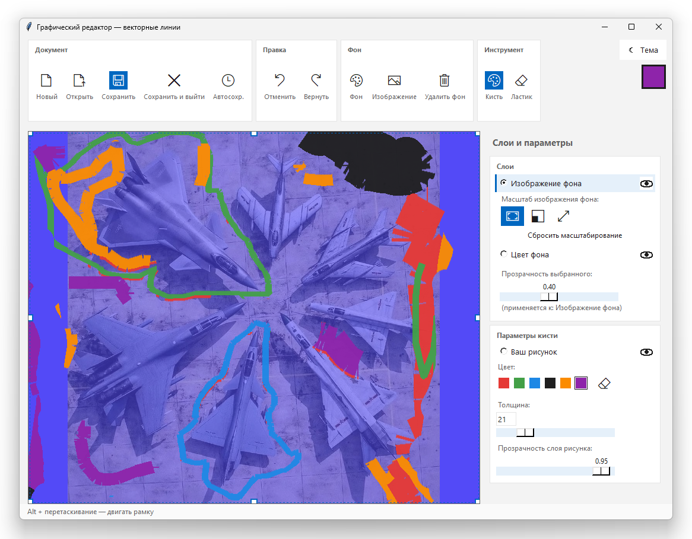

# Задание 4

1. Добавьте в проект графического редактора возможность изменения толщины пера с помощью поля ввода (Entry) и кнопки. Это позволит пользователям вводить желаемую толщину пера.
2. Добавьте поле ввода для задания толщины линии.
3. Добавьте кнопку установки толщины пера.
4. Создайте функцию для обновления толщины пера с обработкой исключения ValueError, которое может возникнуть, если в поле ввода толщины будет введено не целое число.
5. Обновите функцию draw, чтобы она использовала значение толщины, введенное пользователем.



## Графический редактор на Python (Tkinter)

Так как моя основная специальность — компьютерная графика, я отразил в программе упрощённую философию профессиональных программ обработки 2D-графики:
рисование на прозрачном слое, а фоном может быть либо изображение, либо одноцветный фон. Можно также наложить изображение на фон,
а прозрачность каждого слоя можно регулировать относительно другого, что в итоге позволяет добиться более естественных или «драматичных» тонов.

Программа замороченная, но это проба пера — если в дальнейшем придётся заняться импортозамещением Photoshop ;-)
Шутка… тем не менее, в каждой CG-студии есть свои «секретные» кастомные плагины, и знание Python очень востребовано.

## Реализованный функционал (Задание 4)

В рамках выполнения 4-го задания в проект была добавлена возможность гибкой настройки пера:

* **Поле ввода (`Entry`)** для задания точной толщины линии.
* **Кнопка установки толщины пера** (кнопка «OK», а также работает нажатие клавиши `Enter`).
* Создана функция `apply_pen_width()`, которая считывает значение из поля и обрабатывает исключение `ValueError` (если введено не целое число, буквы или пустая строка — программа не падает, а выдаёт предупреждение).
* Новые линии отрисовываются с учётом введённой пользователем толщины.

## 🚀 Установка и запуск

1. Установите необходимые зависимости (для работы с изображениями и форматом EXR):

   ```bash
   pip install Pillow
   pip install openexr-numpy
   ```

2. Запустите файл `Zadanie4.py`.

## Как пользоваться программой

1. Запустите файл `Zadanie4.py`.
2. Для изменения толщины пера введите целое положительное число в поле «Толщина» (в панели справа) и нажмите кнопку **OK** или клавишу **Enter**.
3. Если вы введёте буквы или некорректное число, программа выдаст окно с ошибкой и не сломается.
4. Выберите цвет в палитре и рисуйте на холсте, зажав левую кнопку мыши.

## 🎨 Все возможности программы

### Рисование и инструменты

* **Кисть и ластик:** векторное рисование. Ластик стирает область ровно на толщину кисти (а не просто закрашивает белым).
* **Палитра цветов:** быстрый выбор из базовых цветов, а также индикатор активного цвета в правом верхнем углу.
* **Настройка пера:** помимо поля ввода и кнопки, есть интерактивный ползунок для быстрого изменения толщины.
* **Отмена и возврат:** полноценная поддержка Undo / Redo (горячие клавиши `Ctrl+Z` и `Ctrl+Y`).

### Слои и фон

* **Поддержка слоёв:** рисование происходит на отдельном прозрачном слое.
* **Прозрачность:** ползунок позволяет менять прозрачность как нарисованного слоя, так и фона.
* **Управление видимостью:** иконки «Глаз» (👁) позволяют быстро скрыть или показать слой рисунка, фоновое изображение или цвет фона.
* **Работа с фоновыми изображениями:**
  * Загрузка картинок (поддерживаются PNG, JPEG, BMP, WebP, а также формат EXR).
  * Выбор цвета фона.
  * Настройка масштабирования фона: *Вписать*, *Заполнить* (с обрезкой) или *Растянуть*.

### Трансформация и холст

* **Рамка слоя:** область рисования ограничена пунктирной рамкой с отступом.
* **Масштабирование:** размер слоя можно менять вручную, потянув за специальные квадратики (маркеры) по углам и краям рамки.
* **Перетаскивание:** перемещение всей рамки с рисунком по холсту с помощью `Alt + Левая кнопка мыши`.

### Файлы и безопасность

* **Сохранение / Открытие:** экспорт готового изображения в PNG, JPEG, BMP, WebP или EXR.
* **Автосохранение:** возможность настроить автоматическое сохранение (Выкл / 1 / 5 / 10 / 30 минут).
* **Защита от потери данных:** при закрытии программы или создании нового файла появляется диалоговое окно с предложением сохранить текущий прогресс.
* **Горячие клавиши:** `Ctrl+S` (сохранить), `Ctrl+O` (открыть), `Ctrl+N` (новый файл), `B` (кисть), `E` (ластик).

### Интерфейс

* **Ribbon UI:** современная лента с инструментами, разделённая на логические блоки.
* **Тёмная и светлая темы:** программа автоматически определяет тему оформления Windows (светлая/тёмная) при запуске, но также имеет кнопку для ручного переключения темы (☾).
* **Подсказки:** при наведении на любую кнопку или ползунок появляется всплывающая подсказка с описанием его действия.

## 🛠 Зависимости

Для полноценной работы программы (особенно для работы с изображениями и форматом EXR) требуются сторонние библиотеки:

```bash
pip install Pillow
pip install openexr-numpy
